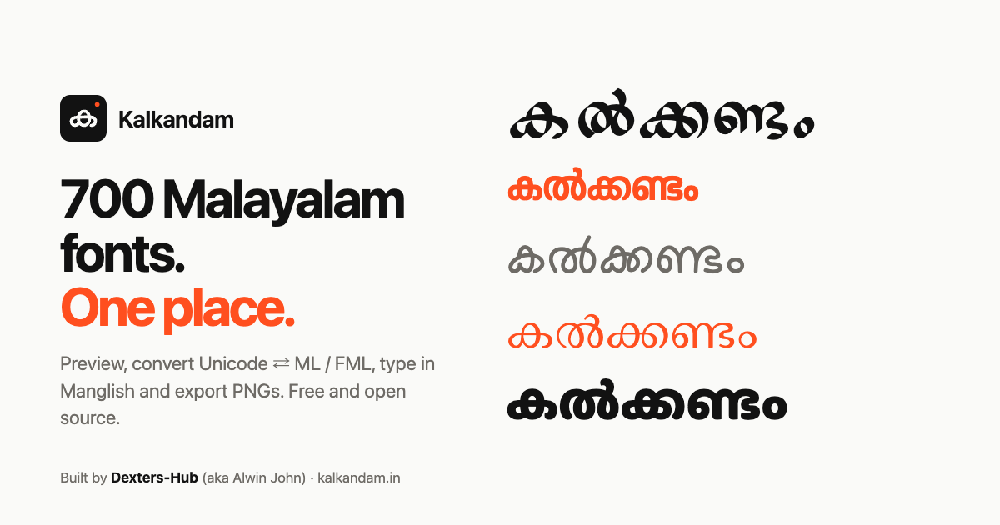
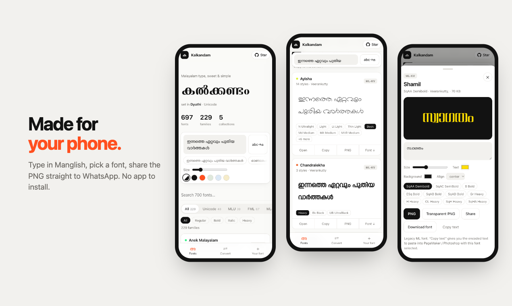

<div align="center">

<a href="https://kalkandam.in"></a>

# Kalkandam · കൽക്കണ്ടം

**700 Malayalam fonts. Preview, convert, download.**

Type once and see it in every font. Built for phones.

[**Open Kalkandam →**](https://kalkandam.in)

[](https://github.com/Dexters-Hub/kalkandam/stargazers)
[](https://kalkandam.in)
[](#the-collection)
[](https://buymeacoffee.com/alwinjohn)
[](https://www.producthunt.com/@alwinjohn)

<a href="https://kalkandam.in"></a>

</div>

## Why

Picking a Malayalam font shouldn't take an afternoon. Fonts are scattered across old websites, many use legacy ML / FML encodings that turn into gibberish when you paste, and almost nothing works on a phone.

Kalkandam puts everything in one fast page.

## Features

|  |  |
| --- | --- |
| 🔤 **Every font, your text** | Type once and see it in 697 fonts across 229 families, rendered live. |
| 🪄 **Legacy fonts just work** | ML-TT, FML and ML-KV fonts get your text in the encoding they expect, so previews never show gibberish. |
| ⇄ **Converter** | Unicode to ML series, Unicode to FML series, ML / FML back to Unicode, and Manglish. The four tools DTP folks use every day. |
| ⌨️ **Manglish typing** | No Malayalam keyboard? Type `ente kEraLam` and get എന്റെ കേരളം. |
| 🖼️ **Export** | PNG, transparent PNG, or share straight to WhatsApp and Instagram from your phone. |
| 📥 **Download** | Get the original font file for Canva, CapCut, Photoshop or your computer. |
| 🧪 **Try your own font** | Drop in any `.ttf` / `.otf` / `.woff`. It never leaves your device. |
| 📱 **Phone first** | Bottom navigation, bottom sheets, swipe to close, installable as an app. |
| ♿ **Accessible** | Keyboard friendly, screen reader labels (legacy previews read as real Malayalam), respects reduced motion, light and dark themes. |

<div align="center">

</div>

## The collection

| Collection | Families | What it is |
| --- | ---: | --- |
| **Unicode** | 40 | Free, openly licensed fonts from [SMC](https://smc.org.in/fonts/), [Rachana Institute of Typography](https://rachana.org.in) and Google Fonts. Manjari, Chilanka, Nupuram, Malini, TN Joy, Sundar and more. |
| **MLU** | 39 | Unicode versions of the classic DTP faces. |
| **FML** | 67 | Legacy ASCII fonts in the FML layout. |
| **ML-TT** | 64 | Legacy ASCII fonts used in PageMaker and Photoshop. |
| **ML-KV** | 19 | Display and poster faces in the ML layout. |

Sources and licences for the Unicode fonts are listed in [`fonts/unicode/SOURCES.md`](fonts/unicode/SOURCES.md).

## How the ML / FML conversion works

Legacy Malayalam fonts reuse ASCII and Latin-1 code points for Malayalam glyphs: `I` is ക, `¡` is ക്ക, `s` is െ. Converting from Unicode means:

1. **Split into syllables:** consonant clusters joined by ്, then an optional vowel sign.
2. **Use ready-made conjunct glyphs,** longest match first: സ്റ്റ → `Ì`, ന്ത → `´`. Anything left keeps a visible chandrakkala (`v`).
3. **Reorder:** െ േ ൈ and ്ര are typed *before* the consonant, so കൈ → `ssI` and ക്രോ → `t{Im`.
4. **Use post-base forms** for ്യ (`y`) and ്വ (`z`).

ML-TT, FML and ML-KV share one layout. The only difference is ണ്ട, which is `U+00AD` in ML and `ï` in FML.

The mapping was reverse-engineered from [kuttipencil.in](https://kuttipencil.in) and checked glyph by glyph against the font files. The converter in [`js/malayalam.js`](js/malayalam.js) is written from scratch, round-trips every consonant × vowel sign and every two-consonant cluster (52,992 cases), and fixes a few kuttipencil bugs along the way: ൈ with ്ര, ZWNJ, ൿ, the സ്ഥ / സ്ല / ല്പ glyphs, and hyphens.

## Run it locally

```sh
git clone https://github.com/Dexters-Hub/kalkandam.git
cd kalkandam
npm start          # http://localhost:8000
npm test           # converter tests (Node 20+)
```

No build step. Plain HTML, CSS and ES modules, with [GSAP](https://gsap.com) for animation.

| Script | What it does |
| --- | --- |
| `npm start` | Serve the site on port 8000 |
| `npm test` | Run the converter tests |
| `npm run build:fonts` | Rebuild `data/fonts.json` and `fonts/web/*.woff` (needs `pip install fonttools`) |
| `npm run vendor:gsap` | Copy GSAP from `node_modules` into `vendor/gsap/` after an upgrade |

## Add a font

1. Put the `.ttf` / `.otf` in the right folder:

   | Folder | For |
   | --- | --- |
   | `fonts/unicode/<Family>/` | Openly licensed Unicode fonts. Include the licence file and add a row to `SOURCES.md`. |
   | `fonts/mlu/` | MLU fonts |
   | `fonts/fml-fonts/` | FML fonts |
   | `fonts/ml-tt/` | ML-TT fonts |
   | `fonts/ml-kv/` | ML-KV fonts |

2. Run `npm run build:fonts`.
3. Open a pull request.

The build reads names and styles from the font files and makes compressed WOFF copies for previews. Originals are never modified; they're what people download. Know a font that should be here? [Open an issue](https://github.com/Dexters-Hub/kalkandam/issues/new).

## Project layout

```
index.html              the whole app
css/app.css             styles (light + dark)
js/app.js               UI
js/malayalam.js         Unicode ⇄ ML / FML / Manglish conversion
js/motion.js            GSAP animations, with a no-motion fallback
data/fonts.json         generated font catalogue
fonts/                  original font files, plus web/ preview copies
scripts/build_fonts.py  catalogue builder
tests/                  converter tests
docs/launch/            Product Hunt kit and screenshots
```

## Support

If Kalkandam saved you time, [⭐ star the repo](https://github.com/Dexters-Hub/kalkandam) or [buy me a coffee](https://buymeacoffee.com/alwinjohn).

## Credits

Built by [Dexters-Hub](https://github.com/Dexters-Hub) (aka Alwin John) · [Product Hunt](https://www.producthunt.com/@alwinjohn)

Fonts belong to their designers and foundries. The Unicode set is openly licensed (see [`SOURCES.md`](fonts/unicode/SOURCES.md)); check each font's terms before commercial use. Thanks to [Swathanthra Malayalam Computing](https://smc.org.in), [Rachana Institute of Typography](https://rachana.org.in) and everyone who has kept Malayalam type alive.
